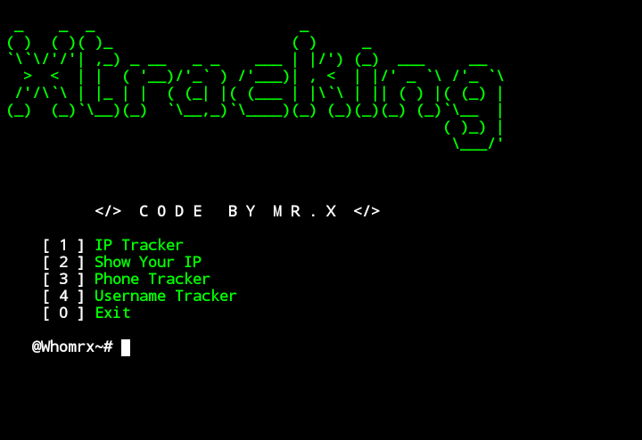

# Xtracking 2


## introduction
This is a tool for tracking someone

## Instalations
```
$ apt update
$ apt upgrade
$ pkg install git
$ pkg install python
$ pkg install python3
$ git clone https://github.com/Whomrx666/Xtracking.git
$ cd Xtracking 
$ pip install -r requirements.txt
$ python3 Xtracking.py
```

## Instructions
- **IP Tracker**: To track someone's IP address 
- **Show Your IP**: To see your own IP address
- **Phone Tracker**: To track someone's phone number
- **Username Tracker**: To track people by name
- **Exit**: To exit tools
### Original Author
<a href="https://github.com/Whomrx666"></a>

## CONNECT WITH ME :

[](https://whomrxhackers.blogspot.com/)
[](https://twitter.com/whomrx666)
[](https://wa.me/6285926601133?text=Halo%2C%20Mr.X)
[](https://www.facebook.com/whomrx.666)
[](https://t.me/Whomr_X)
[](mailto:whomrx666@gmail.com)
[](https://www.tiktok.com/@whomr.x)

**If you want to donate, click on the button**
<a href="https://saweria.co/whomrx"></a>

---

<p align="left">
  
</p>

---
